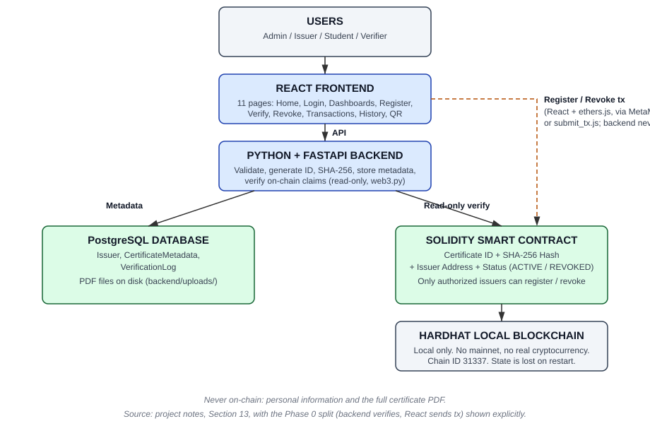
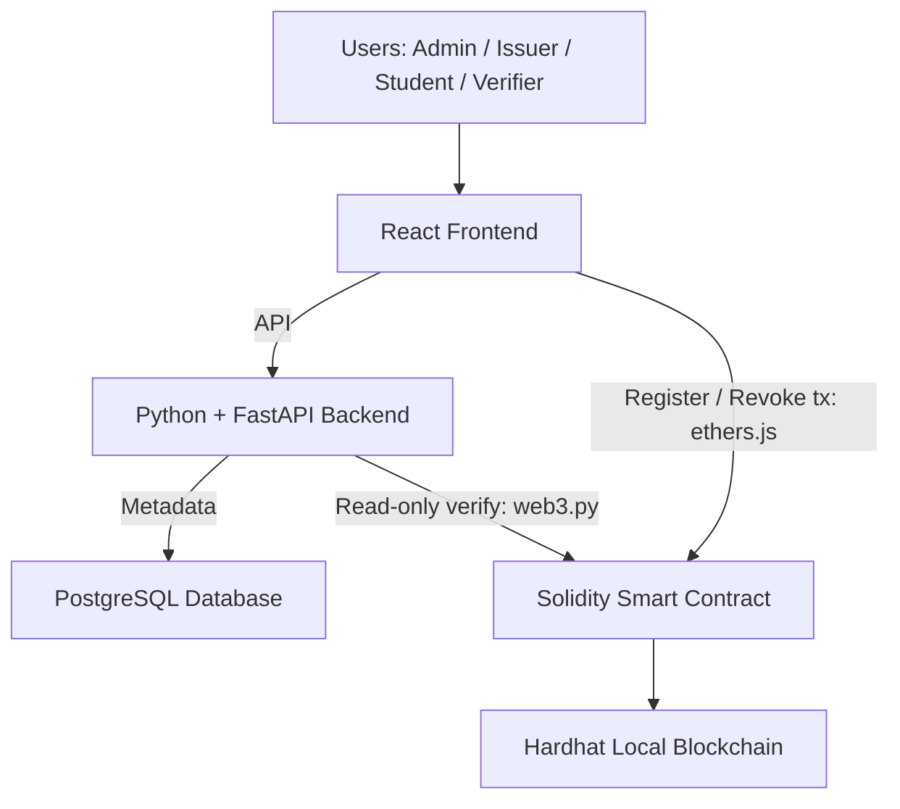

# Blockchain-Based Academic Certificate Verification System

**Submission document — Phase 7**

> Before submitting, fill in the placeholders marked `[to fill in]`:
> student name, roll number, college, guide name, and submission date.
> No personal details have been invented in this document. Example values
> from the project notes (such as `CERT-X7K29A`, `83af92...`, `0x827ab...`,
> and dashboard totals) are placeholders from the notes, not real data.
> Real IDs, hashes, and transaction hashes from the demo run are in
> `demo/DEMO_RESULT.md` and change on every run.

## 1. Introduction

Academic certificates are easy to copy and hard to check. An employer or
institution that receives a certificate PDF usually has no quick,
reliable way to tell whether the file is the original, whether it was
changed, or whether it was revoked after issue.

This project builds a system to securely issue, store, verify, and
revoke academic certificates. It uses SHA-256 hashing to generate a
unique digital fingerprint of each certificate PDF. Important
verification information is stored on a local blockchain, while student
details and other certificate metadata are stored in a PostgreSQL
database. A verifier can then tell whether a certificate is **Valid,
Modified, Revoked, or Not Found**.

This is a local demo system. It uses a Hardhat local blockchain, not
the real Ethereum mainnet, and no real cryptocurrency is used.

## 2. Objectives, and where each one is implemented

From the project notes, Section 3:

| # | Objective | How it is implemented | Evidence |
|---|---|---|---|
| 1 | Secure verification of academic certificates | SHA-256 fingerprint + on-chain record; backend verifies the on-chain hash, issuer, and status before confirming anything | `backend/app/blockchain.py`, `POST /verify` |
| 2 | Detect modified or tampered files | Any change to the file changes its SHA-256; verification compares the uploaded hash with the on-chain hash | Demo case 3: 1-byte change → MODIFIED |
| 3 | Only authorized issuers can register | Authorization checked in the backend (PENDING → 403) and in the contract (unauthorized register reverts) | Demo case 6: both paths REJECTED |
| 4 | Authorized issuers can revoke | Revoke transaction changes status ACTIVE → REVOKED; the record is never deleted | Demo case 4: REVOKED |
| 5 | Students can download and share | Student page: view details, download PDF, Certificate ID, QR code, copy share link — by ID/QR, no student password | `frontend/src/pages/StudentCertificate.jsx` |
| 6 | Verifiers can verify by uploading the PDF | Public Verify page, no login: upload PDF → result | `POST /verify`, Verify page |
| 7 | Maintain a verification history | Every verification attempt is written to VerificationLog | History page, demo history check |
| 8 | QR-based reference and verification | QR encodes the verification-page URL + Certificate ID; scanning opens ID lookup | QR page, demo QR check |
| 9 | Maintain verification records using blockchain | On-chain record per certificate: ID + hash + issuer + status | Contract, demo cases 1–4 |

## 3. Users and their responsibilities

From the project notes, Section 4. Login and access details that the
notes do not state are Phase 0 decisions (see `DECISIONS.md` in this
pack); they are marked as decisions, not as notes requirements.

- **Administrator.** Manages authorized issuers: authorize a
  college/issuer, view authorized issuers, manage issuer access, prevent
  unauthorized users from issuing certificates. Flow: Admin Login →
  Issuer Administration → Authorize Issuer. Login: email + password,
  one seeded demo Admin, no public signup (Phase 0 decision).
- **Issuer / College.** Uploads certificates, registers certificates,
  views issued certificates, revokes certificates, views blockchain
  transaction status. Flow: Issuer Login → Dashboard → Upload →
  Register → Blockchain Transaction. Login: email + password, activated
  when the Admin authorizes the issuer (Phase 0 decision).
- **Student.** Views certificate details, downloads the certificate,
  accesses the Certificate ID and QR code, shares the certificate
  reference. Access: by Certificate ID or QR code only, no student
  password (Phase 0 decision). The notes give no student login flow,
  and none was invented.
- **Verifier.** Uploads a certificate PDF, verifies it, views the
  result. Fully public, no login (Phase 0 decision; the notes call this
  the Public Certificate Verification Page).

Transaction Status and Verification History are visible to the Issuer
(own certificates) and the Admin, not to the public (Phase 0 decision;
the notes list the pages but do not state an audience).

## 4. Technologies used

From the project notes, Section 5 and Final Technology Structure.
Versions below are the exact versions installed and verified in this
build, not versions from the notes (the notes state no versions).

| Technology | Purpose | Version in this build |
|---|---|---|
| React | Frontend | 18.3.1 |
| Python | Backend programming | 3.12.3 |
| FastAPI | Backend API | 0.162.0 |
| PostgreSQL | Database | 16.15 |
| Solidity | Smart contract | 0.8.28 |
| Hardhat | Local blockchain | 2.29.1 |
| SHA-256 | Hashing | Standard SHA-256 (256-bit) |
| ethers.js | Blockchain communication (writes) | 6.17.0 |
| web3.py | Blockchain reads from the backend | 8.0.0 |
| QR Code | Certificate reference | qrcode.react 4.2.0 |
| Vite | Frontend build/dev | 5.4.21 |
| react-router-dom | Frontend routing | 6.30.6 |
| SQLAlchemy / psycopg2-binary | Database access | 2.1.6 / 2.9.13 |
| Uvicorn / Pydantic / pytest | Backend server / validation / tests | 0.54.0 / 2.14.1 / 9.1.1 |
| Node / npm | JavaScript runtime / packages | v24.22.1 / 10.9.4 |
| reportlab | Demo PDF generation only | 5.1.0 |

Certificate format: PDF. Blockchain communication: ethers.js for
transactions, web3.py for backend reads (see Section 5).

## 5. Overall system architecture

From the project notes, Section 13, with one Phase 0 clarification
shown explicitly: the notes say the backend “communicates with the
blockchain”, but ethers.js is a JavaScript library and the backend is
Python, so the write path had to be split. The confirmed split is:

- **FastAPI** validates the request, generates the Certificate ID,
  calculates SHA-256, and stores metadata first.
- **React + ethers.js** then sends the register / revoke transaction
  (via MetaMask, or via `blockchain/scripts/submit_tx.js` as a fallback).
- **FastAPI + web3.py (read-only)** then verifies the transaction
  receipt and the on-chain record before marking the certificate
  ACTIVE or REVOKED. The backend never sends a transaction, and it
  never marks a certificate ACTIVE/REVOKED on an unconfirmed claim:
  a fake confirmation is rejected with HTTP 409 and the database
  status is left unchanged.





Personal information and the complete certificate PDF are **never**
stored on the blockchain (notes, Section 8). The PDF is stored on disk
in the backend uploads folder, with its path in CertificateMetadata
(Phase 0 decision).

## 6. Database (PostgreSQL)

From the project notes, Section 8. The three records are:

- **Issuer:** Issuer ID, College Name, Wallet Address, Authorization
  Status.
- **CertificateMetadata:** Certificate ID, Student Name, Course,
  Certificate File, Issue Date. The registration form also asks for
  College (notes, Section 14).
- **VerificationLog:** Verification ID, Certificate ID, Verification
  Date, Verification Result.

Implementation extensions beyond Section 8, documented here so they
are not mistaken for notes requirements:

- `issuers` also stores `email` and `password_hash` (for the Phase 0
  email/password login) and `created_at`. Authorization status values
  are `PENDING` and `AUTHORIZED` (the notes do not name values).
- `certificate_metadata` also stores `college`, `issuer_id`,
  `sha256_hash`, `blockchain_tx_hash`, and `blockchain_status`.
- `verification_logs.certificate_id` is deliberately **not** a foreign
  key, so verifications of unknown IDs can still be logged (as
  `UNKNOWN` when no ID was supplied and no hash matched, or under the
  unknown ID that was supplied).
- PDF validation is: `.pdf` extension + `%PDF` magic bytes + 10 MB
  cap. The cap is an implementation safeguard, not a notes rule.

## 7. Blockchain and SHA-256

From the project notes, Sections 9, 10, and 12.

Only the minimum required information is stored on-chain per
certificate:

```
Certificate ID + SHA-256 Hash + Issuer Address + Certificate Status (ACTIVE)
```

The contract stores the hash as an opaque 32-byte value; it never sees
the PDF file. Contract status values are: `0 = None (NOT_FOUND)`,
`1 = Active`, `2 = Revoked`.

SHA-256 generates a unique 256-bit fingerprint of the exact PDF file.
If the file is changed, even slightly, its hash changes, so the system
can detect modification. This is why the demo must keep byte-identical
originals: re-saving a PDF (even without visible changes) changes its
hash and makes it verify as MODIFIED.

**Important implementation finding (Phase 5, not a notes rule):**
MODIFIED requires a Certificate ID. A modified file has a brand-new
hash, and a hash cannot be reversed to find its original. The contract
is keyed by Certificate ID, not by hash, so without an ID there is
nothing to compare a modified file against: a hash-only lookup of an
unknown hash correctly returns NOT_FOUND, never a guessed MODIFIED.
With an ID supplied, the system compares the uploaded hash with that
certificate's on-chain hash: match = VALID, mismatch = MODIFIED. The
Verify page explains this, and the demo supplies the ID for the
MODIFIED case.

Hardhat is used only as a local blockchain for development and
testing. Real Ethereum Mainnet is not required, and real cryptocurrency
is not required. Hardhat local state is volatile: restarting the node
loses the deployed contract, so the deploy step must be repeated and
the new contract address recorded (see `RUNBOOK.md`).

## 8. Smart contract

From the project notes, Section 11. The contract
(`blockchain/contracts/CertificateVerification.sol`) implements
exactly the five operations in the notes, no more:

1. Authorize Issuer
2. Register Certificate
3. Get Certificate Record
4. Revoke Certificate
5. Check Certificate Status

Rules enforced by the contract:

- Only an authorized issuer may register or revoke a certificate.
- Revocation changes status ACTIVE → REVOKED; the record is **never
  deleted**, and a revoked record remains readable with its original
  hash and issuer (notes, Section 17).
- Duplicate registration of the same Certificate ID is rejected.
- An unknown Certificate ID returns status None (NOT_FOUND).
- The contract deployer is the Admin.

One rule the notes do **not** state, so none was added: the notes do
not say revocation is restricted to the original issuer, so the
contract allows any authorized issuer to revoke. This is documented
in the contract and its README, not hidden.

## 9. Frontend

From the project notes, Section 6. All 11 pages are implemented and
routed in `frontend/src/App.jsx`:

Home, Login, Admin Dashboard, Issuer Dashboard, Certificate
Registration, Student Certificate List, Certificate Verification,
Revocation, Transaction Status, Verification History, QR Verification.

### Designs from the notes, Section 14

The notes give designs for four pages only. Those four are reproduced
below in the notes' own terms; the other seven pages follow the same
header/navigation style but have no design in the notes, so no design
is claimed for them.

**Home Page.** Header: “Academic Certificate Verification”, with
Home / Verify Certificate / Login. Hero: “Verify Academic
Certificates Securely Using Blockchain”, with a [Verify Certificate]
button.

**Issuer Dashboard.** Sidebar: Dashboard, Register Certificate,
Certificates, Revoke, Logout. Main area: “ISSUER DASHBOARD”, Total
Certificates, Active, Revoked, [Register Certificate], Recent
Certificates. The notes show totals 10 / 9 / 1 as an example layout;
those numbers are placeholders in the notes, not real data. In the
demo run the dashboard would show 10 total, 9 Active, 1 Revoked,
because the demo registers 10 certificates and revokes 1 — that is
the demo's actual result, not the notes' example.

**Certificate Registration Page.** Fields: Student Name, Course,
College, Issue Date, Certificate PDF [Choose File],
[REGISTER CERTIFICATE]. After successful registration, the success
screen shows: Certificate ID, SHA-256, Transaction, Status ACTIVE,
and a QR code. In this implementation the QR code is shown only once
the certificate is confirmed ACTIVE (before that, registration is not
yet complete on-chain).

**Public Certificate Verification Page.** Upload Certificate PDF,
[Choose Certificate], [VERIFY]. The result can be VALID, MODIFIED,
REVOKED, or NOT FOUND. In this implementation the page has two
separate sections (see Section 11), because the notes' Section 18
rule requires ID lookup and file verification to stay separate.

## 10. Certificate registration flow

From the project notes, Section 15, with the Phase 0 split applied:

```
START
  |
  v
Issuer Login
  |
  v
Is Issuer Authorized? -- NO --> Reject (backend: HTTP 403)
  |
 YES
  |
  v
Upload Certificate (PDF)
  |
  v
Generate Certificate ID (CERT- + 6 uppercase letters/digits, unique in PostgreSQL)
  |
  v
Calculate SHA-256
  |
  v
Store Metadata in PostgreSQL (status: NOT_REGISTERED_ONCHAIN)
  |
  v
Call Smart Contract (React + ethers.js sends the register transaction)
  |
  v
Store ID + Hash + Issuer + Status on-chain; Blockchain Transaction
  |
  v
Backend verifies receipt + on-chain hash/issuer/status, then marks ACTIVE
  |
  v
Generate QR Code (verification-page URL + Certificate ID)
  |
  v
Certificate Registered
  |
  v
END
```

## 11. Certificate verification flow

From the project notes, Section 16, followed in exactly this order
by `POST /verify`. The blockchain record is the source of truth; the
database is used only to resolve an ID and to supply student/course/
college details for display.

```
START
  |
  v
Upload Certificate PDF
  |
  v
Calculate SHA-256 Hash
  |
  v
Get Blockchain Record (for the resolved Certificate ID)
  |
  v
Record Exists? -- NO --> NOT FOUND
  |
 YES
  |
  v
Revoked? -- YES --> REVOKED (checked before hash comparison, so even a
  |                   byte-identical file of a revoked certificate is REVOKED)
  |
  NO
  |
  v
Compare Hash -- Match --> VALID
  |
  +-- Mismatch --> MODIFIED
```

How the Certificate ID is resolved (Phase 5 implementation, following
from the contract being keyed by ID): if the verifier supplies an ID,
that ID is used; otherwise the system looks up a database record by
the uploaded hash and uses its ID; if neither finds an ID, the result
is NOT FOUND.

Every returned result is written to VerificationLog before responding.
A non-PDF upload is rejected with HTTP 400 and no log is written.
If the contract is not configured, the endpoint returns HTTP 503 and
no log is written, rather than a fake result. If the blockchain read
fails, it returns HTTP 502 and no log is written.

### ID lookup vs file verification (notes, Section 18)

This rule is kept strictly, in both the backend and the frontend:

- **ID Lookup = Record Lookup.** Entering a Certificate ID that
  exists shows “Record Found” (metadata only). It must not be labelled
  VALID, and it does not prove any file is valid.
- **PDF Hash Match = File Verification.** Only uploading a PDF and
  comparing its SHA-256 with the on-chain hash can return VALID.

The QR code encodes the verification-page URL + Certificate ID, so
scanning a QR code opens ID lookup. It does not by itself prove a
file is valid.

## 12. Certificate revocation flow

From the project notes, Section 17:

```
Issuer Login
  |
  v
Select Certificate
  |
  v
Click Revoke
  |
  v
Check Issuer Authorization
  |
  v
Call Smart Contract (React + ethers.js sends the revoke transaction)
  |
  v
ACTIVE -> REVOKED
  |
  v
Record Blockchain Transaction
  |
  v
Certificate Status Updated (backend confirms receipt + on-chain status, then marks REVOKED)
```

The certificate record is not deleted from the blockchain. Its status
changes from Active to Revoked, so the previous ledger record and
history remain available.

## 13. Complete project flow

From the project notes, Section 20:

```
Admin Authorizes Issuer
  |
  v
Issuer Uploads Certificate
  |
  v
FastAPI Receives Certificate
  |
  v
Generate Certificate ID
  |
  v
Generate SHA-256 Hash
  |
  v
Store Metadata in PostgreSQL
  |
  v
Register Certificate Through Solidity Smart Contract
  |
  v
Hardhat Blockchain Records Transaction
  |
  v
Generate QR / Certificate Reference
  |
  v
Student Receives Certificate
  |
  v
Verifier Uploads Certificate
  |
  v
SHA-256 Generated Again
  |
  v
Compare With Blockchain Record
  |
  v
VALID / MODIFIED / REVOKED / NOT FOUND
```

## 14. Testing and acceptance demonstration

From the project notes, Section 19. The demo creates 10
synthetic/sample certificates and demonstrates, in order:

| # | Case | Expected | Actual (demo run, 2026-10-25) |
|---|---|---|---|
| 1 | Register 10 certificates | 10 ACTIVE | PASS — 10 ACTIVE |
| 2 | Upload an original certificate | VALID | PASS — VALID (no ID supplied, fingerprint lookup) |
| 3 | Modify one byte/file content and upload it | MODIFIED | PASS — MODIFIED (exactly 1 byte changed, ID supplied; see Section 7) |
| 4 | Revoke one certificate | REVOKED | PASS — REVOKED (original file, after revocation) |
| 5 | Search an unknown Certificate ID | NOT FOUND | PASS — lookup 404, verification NOT_FOUND (`CERT-UNKNOWN`, never registered) |
| 6 | Try to issue using an unauthorized account | REJECTED | PASS — backend 403 for a PENDING issuer, and contract revert for an unauthorised wallet; no certificate created by either attempt |
| 7 | Test smart-contract permissions automatically | Tests pass | PASS — `npx hardhat test`: 11 passing, 0 failing |

The demo is fully automated in `demo/run_demo.py` and its evidence is
in `demo/DEMO_RESULT.md`, including the 10 certificates' IDs, SHA-256
hashes, and transaction hashes from that run. Those IDs and hashes
change on every run (IDs are generated randomly, hashes come from a
fresh local chain), so `DEMO_RESULT.md` is evidence for the run that
produced it, not a fixed fixture. Re-running the demo overwrites it
with the new run's values. The demo also checks two extras: a QR link
opens the record, and the verification history contains all four
results.

Automated test totals, re-verified for this pack:

- Backend: **24 pytest tests pass** (API, services, blockchain
  confirmation, and `/verify` tests).
- Contract: **11 Hardhat tests pass**, including unauthorized
  register/revoke rejection, duplicate ID rejection, revocation
  keeping the record readable, and unknown ID returning None.
- Frontend: **Vite build passes**.
- Live end-to-end checks: Phase 3 and Phase 5 live checks pass
  (upload → register → confirm → verify → revoke → verify on a real
  local Hardhat node and backend).

All 10 demo PDFs are synthetic samples, labelled as such inside each
PDF, in `demo/certificates/`. No real student data is used.

## 15. Limitations — what this project is not

Honest limits, so the submission does not claim more than was built:

- **Local demo only.** Hardhat local blockchain, local PostgreSQL,
  local file storage. No mainnet, no real cryptocurrency, no
  production deployment, no cloud hosting.
- **Upload-only.** Certificate “generation” appears in one line of
  the notes with no method given, so it is out of scope. Certificates
  are uploaded as PDFs, not generated by the system.
- **Demo authentication.** Admin/Issuer login uses PBKDF2 password
  hashes and random in-memory tokens valid for 24 hours, lost on
  backend restart. There is no JWT, refresh token, password reset, or
  email verification, because the notes do not ask for them. Demo
  credentials are `admin@demo.local` / `admin123` and
  `demo-issuer@demo.local` / `demo123` — change them for any real use.
- **Volatile blockchain state.** Restarting the Hardhat node loses
  the deployed contract and all on-chain records; the system must be
  redeployed and certificates re-registered. The database and the
  chain can therefore disagree after a restart, and the backend
  reports on-chain status as the source of truth.
- **No student accounts.** Students access certificates by ID/QR
  only. Anyone with a Certificate ID can view that record and
  download its PDF — that is the Phase 0 decision, and it is suitable
  for a college demo, not for private records.
- **No email, SMS, or external verification.** Verification is by
  PDF upload or ID lookup only.
- **Single-machine demo.** The frontend, backend, database, and
  blockchain are assumed to run on the same machine (or local network)
  for the demo.

## 16. Future work (not built — proposals only)

These are ideas for later work, not claims about this build:

- Persistent, production-grade authentication (for example JWT with
  refresh and password reset) instead of in-memory tokens.
- Certificate generation inside the system, in addition to upload.
- A persistent blockchain network (testnet) or a hosted database, so
  records survive restarts — with the privacy and cost trade-offs
  that would need to be considered.
- Student accounts with private access, if student records need to
  be restricted.

## 17. Project structure

```
certificate-verification-blockchain/
  README.md                  Project overview and status
  docs/
    PLAN.md                  Phase-wise plan, gaps, risks
    DECISIONS.md             Phase 0 decisions log (also in this pack)
  blockchain/
    contracts/CertificateVerification.sol
    scripts/deploy.js        Deploy to a local Hardhat node
    scripts/submit_tx.js     ethers.js write path (authorize/register/revoke/read)
    test/CertificateVerification.test.js   (11 tests)
  backend/
    app/                     FastAPI app: main, models, schemas, services,
                             blockchain (web3.py read-only), auth
    app/contract_abi.json    Contract ABI (regenerate if the contract changes)
    tests/                   pytest suite (24 tests) + live checks
    requirements.txt
  frontend/
    src/                     React 18 app: 11 pages, api/auth/blockchain libs
    .env.example             VITE_API_URL, VITE_CONTRACT_ADDRESS, VITE_RPC_URL
  demo/
    run_demo.py              Section 19 acceptance demo (automated)
    DEMO_RESULT.md           Evidence from the latest demo run
    README.md                Presenter checklist + frontend demo steps
    certificates/            10 synthetic sample PDFs + 1 modified PDF
  submission/                This pack
    SUBMISSION.md            This document
    architecture.svg         System architecture diagram
    RUNBOOK.md               Clean local start + demo reproduction steps
    DECISIONS.md             Phase 0 decisions log
```

## 18. How to run it

See `RUNBOOK.md` in this pack for the full, tested steps from a clean
local start: PostgreSQL, Hardhat node + deploy, backend, frontend,
demo login credentials, the demo script, and troubleshooting for the
known quirks (volatile Hardhat state, PDF re-saving changing the hash,
Vite localhost handling, and tokens lost on restart).

## 19. Source of truth

This document is based on the project notes file
(`Blockchain_Based_Academic_Certificate_Verification_Full_Notes.md`),
sections 1–20 and Final Technology Structure. Where the notes do not
state a point, this document says so and points to the Phase 0
decisions log instead of presenting a decision as a notes requirement.
Where the implementation extends the notes (database fields, PDF
validation, token scheme, MODIFIED-needs-ID), the extension is
labelled as such in the section where it appears.
